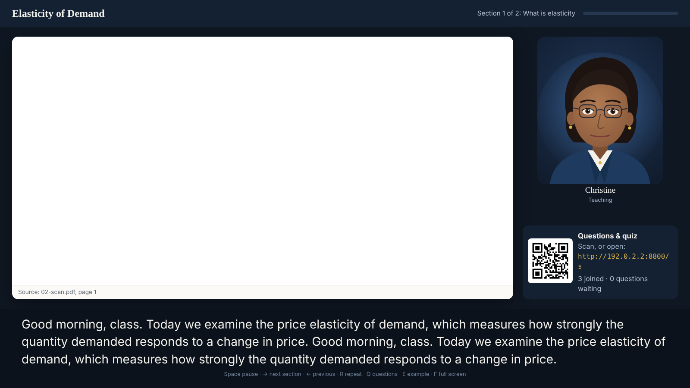
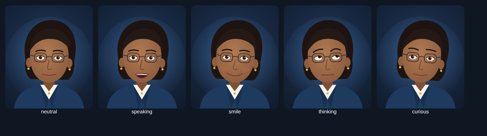

# Christine: your voice assistant for Windows

Christine runs on your Windows computer and does what you tell her by voice. She can
find and open your documents, tell you when the battery is low, delete things (only
after you confirm **twice**), bring files back from the Recycle Bin, open and close
websites and programs, read manuals and articles aloud, sing, tell jokes, chat for as
long as you like, and remember things about you between sessions.

## Install

1. Download this folder and unzip it anywhere.
2. Double-click **`install.bat`**. The installer:
   - installs Python 3.12 if you don't have it (using winget),
   - sets up Christine in `%LOCALAPPDATA%\Christine`,
   - asks for your **Claude API key**: create one at <https://console.anthropic.com/settings/keys>,
     click its copy button, then just press **Enter** in the installer (it reads the key from
     your clipboard; Ctrl+V does not work in that window),
   - puts a **Christine** shortcut on your Desktop and in the Start Menu,
   - can optionally start Christine whenever Windows starts.
3. Double-click **Christine** on the Desktop. The first launch downloads the speech
   model (about 150 MB).

You'll need a microphone and speakers. A headset works best in noisy rooms.

## Christine Classroom: teaching a course unit

Christine can teach a whole course unit on a projector, take questions from students'
phones, run a quiz, mark it and give you the results in Excel.




### Before the first class (once)
1. Run **Classroom network setup (run once as admin)** from the Start Menu. It lets
   students' phones reach the laptop through Windows Firewall, and raises the laptop
   hotspot's limit from 8 to 100 devices.
2. **Connecting 30–100 students.** The phones must be on the same network as the laptop:
   - **Laptop hotspot** (built in): press *Turn on hotspot* on the dashboard. Students
     scan the Wi-Fi QR code. Many laptops' Wi-Fi cards still cap the hotspot at around
     8–30 devices, even after the setup step. Test it with your own class size first.
   - **A portable Wi-Fi router** (a travel router or MiFi, ideally one rated for 32+
     devices) is the reliable option for 50–100 students. Connect the laptop and the
     students to it.
   - **Campus Wi-Fi** works only if it lets devices see each other. Many campus networks
     block this.

### Preparing a lesson
1. Double-click **Christine Classroom** on the Desktop. The dashboard opens in your browser.
2. Under **New lesson**, give the title, course code, level and teaching time, then upload
   the unit's files: **PDF, Word (.docx), PowerPoint (.pptx), or photos of handwritten
   notes** (JPG/PNG). Save old .doc/.ppt files in the new format first.
3. Christine reads everything (including handwriting), plans the sections, writes the full
   lecture script and builds the quiz (multiple choice plus short answers with a rubric).
   This takes a few minutes.
4. **Review everything.** Edit any script, key point, slide choice, quiz question, answer or
   rubric. Christine speaks the scripts exactly as approved. Then press **Approve lesson**.

### Teaching
1. Connect the laptop to the projector. Press **Start class**: the classroom display opens
   in a new window. Drag it to the projector and click **Start display** (this turns on
   sound and full screen).
2. Students scan the QR code on screen, then enter their **name and matric number**.
3. Press **Begin lesson** on the dashboard. Christine teaches section by section. Her face
   moves with her voice, and captions run along the bottom. Your PowerPoint or PDF page
   is shown, or a slide she draws when there isn't one.
4. Students type questions at any time. After each section, Christine reads each question
   out (rephrased neutrally) and answers it from the course material. Inappropriate
   questions are skipped and listed for you. You can hide any question. To approve each
   question before she answers it, set `approve_questions = true` in the settings.
5. Control her from the dashboard, from your phone (open the *phone remote* address shown
   on the dashboard and enter the PIN), or from the keyboard on the display: **Space**
   pause/resume, **→** next section, **←** previous section, **R** repeat, **Q** take
   questions now, **E** give another example.
6. At the end she opens the quiz on students' phones. Press **Close quiz and mark**.
   Multiple choice is marked instantly; Christine marks the short answers with your rubric
   and announces the class average.
7. **Check her marking** on the dashboard and change any mark. Then press **Release results**
   so students see their scores and feedback, and **Download Excel** for the records
   (scores, every answer, every question asked).

The lecturing voice is Nigerian English (`en-NG-EzinneNeural`) by default. Change it in the
settings file under `[classroom]`, for example to `en-NG-AbeoNeural` (male) or
`en-GB-SoniaNeural` (British). If the internet voice is unavailable, the projector uses
the laptop's own voice.

**Cost:** a 50-minute lesson, including preparation, questions and marking for about 100
students, typically costs around US$1–3 in Claude usage with the default model.

## Talking to Christine

Say **"Christine"** followed by what you want, or press **Ctrl+Alt+C** and then speak.
After she answers you have 8 seconds to say something else without repeating her name.
Press **Ctrl+Alt+S** to stop her talking, reading or singing.

| Say... | What happens |
|---|---|
| "Christine, how's my battery?" | Gives the battery level and time left |
| "Christine, where is my tax return?" | Searches your folders and tells you where it is |
| "Christine, open the budget spreadsheet" | Finds the file and opens it |
| "Christine, delete the old CV in Downloads" | Asks **twice** and then moves it to the Recycle Bin |
| "Christine, bring back the file I deleted" / "undo that" | Restores it from the Recycle Bin |
| "Christine, what's in the Recycle Bin?" | Lists what's in there |
| "Christine, open YouTube" / "close YouTube" | Opens or closes the site |
| "Christine, open Word" / "close Spotify" | Opens or closes the program |
| "Christine, check my system" | Reports on battery, CPU, memory, disk space and busy programs |
| "Christine, what's inside my computer?" | Describes the processor, RAM, graphics and model |
| "Christine, read this manual to me" | Reads it aloud. Ctrl+Alt+S stops it; "continue reading" picks up where she left off |
| "Christine, summarise this article: punchng.com/..." | Gives a short summary |
| "Christine, I'm bored" | Offers jokes, games or a song |
| "Christine, check the system and sing" | Sings a song about how your computer is doing |
| "Christine, remember that my sister's birthday is 3 May" | Saves it to her memory |
| "Christine, what do you remember about me?" | Tells you what she has saved |
| "Christine, go to sleep" / "exit" | Stops listening until you say her name / closes Christine |

She also speaks up by herself when the battery drops to 20%, 10% and 5%, and when the
charger is plugged in or unplugged.

## Safety: deleting

- Every delete (files, folders, and saved memories) needs **two separate confirmations**:
  1. "Are you sure?" You answer **yes**.
  2. "Second confirmation... say: confirm delete." You answer **confirm delete**.
  Anything else, or saying "no", "cancel" or "stop" at either step, cancels the delete.
- This check is in Christine's own code (`christine/safety.py`). The AI cannot skip it.
- Deleted items always go to the **Recycle Bin**. Christine cannot delete anything
  permanently and cannot empty the Recycle Bin.
- She refuses to touch Windows, Program Files, AppData, drive roots and your main user
  folders (Desktop, Documents and so on).
- Closing a program asks you once, because unsaved work could be lost.

## How the hybrid setup works

| Part | Where it runs | Cost |
|---|---|---|
| Hearing (speech to text) | **Your computer** (faster-whisper) | Free |
| Wake word, battery, time, date, opening and closing websites | **Your computer** | Free, and works offline |
| Conversation, finding files, multi-step tasks | **Cloud** (Claude) | Pay per use |
| Voice | Microsoft neural voice (free, online); falls back to the Windows voice offline | Free |

Without internet or an API key, Christine still handles the free local commands and tells
offline jokes. For offline conversation too, install [Ollama](https://ollama.com),
run `ollama pull llama3.2`, and set `ollama_model = "llama3.2"` in the settings.

**About cost:** the default brain is `claude-opus-5-5` (the most capable) at a low
"effort" setting, which keeps replies quick. If you chat with her for hours, it's much
cheaper to set `model = "claude-sonnet-5-5"` or `"claude-haiku-5-5"` in the settings.
You can track your spending in the Anthropic Console.

## Settings

Edit `%APPDATA%\Christine\config.toml` (open it by typing that path into the File
Explorer address bar), then restart Christine. You can change her voice (for example
`en-GB-SoniaNeural` or `en-US-JennyNeural`), speaking speed, hotkeys, battery warning
levels, which folders she searches, and how sensitive the microphone is. To change your
API key, use the Start Menu shortcut **Christine - set API key**. If Christine says
something went wrong in her cloud brain, run **Christine connection check** and look at
what it reports.

Your memories are stored in `%APPDATA%\Christine\memory.db` and stay on your computer.
Uninstalling keeps them unless you delete that folder.

## Known limits

- **Singing** uses the speaking voice with a melody of pitch and speed changes. It's
  fun, but it isn't a real singing voice.
- **Closing websites** closes the browser *window* whose title matches. Sites Christine
  opens get their own window, so this works well for those. A site sitting in a tab
  behind other tabs can't be found.
- While Christine is talking she isn't listening. Use **Ctrl+Alt+S** to interrupt her.
- Scanned PDFs (images of pages) have no text she can read.

## For developers

```bash
pip install -r requirements.txt pytest
python -m pytest            # safety, memory, file search, routing, brain loop
python -m christine --text  # type instead of talk; useful for testing
```

Project layout: `christine/app.py` (main loop), `brain.py` (Claude and tools),
`router.py` (free local commands), `safety.py` (double confirmation and protected
paths), `memory.py`, `monitor.py` (battery), `audio/` (ears and voice), `tools/`
(everything she can do).
