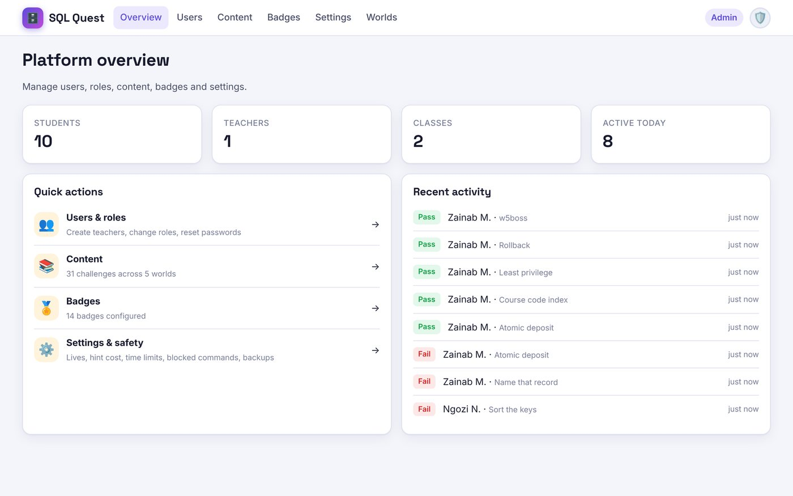
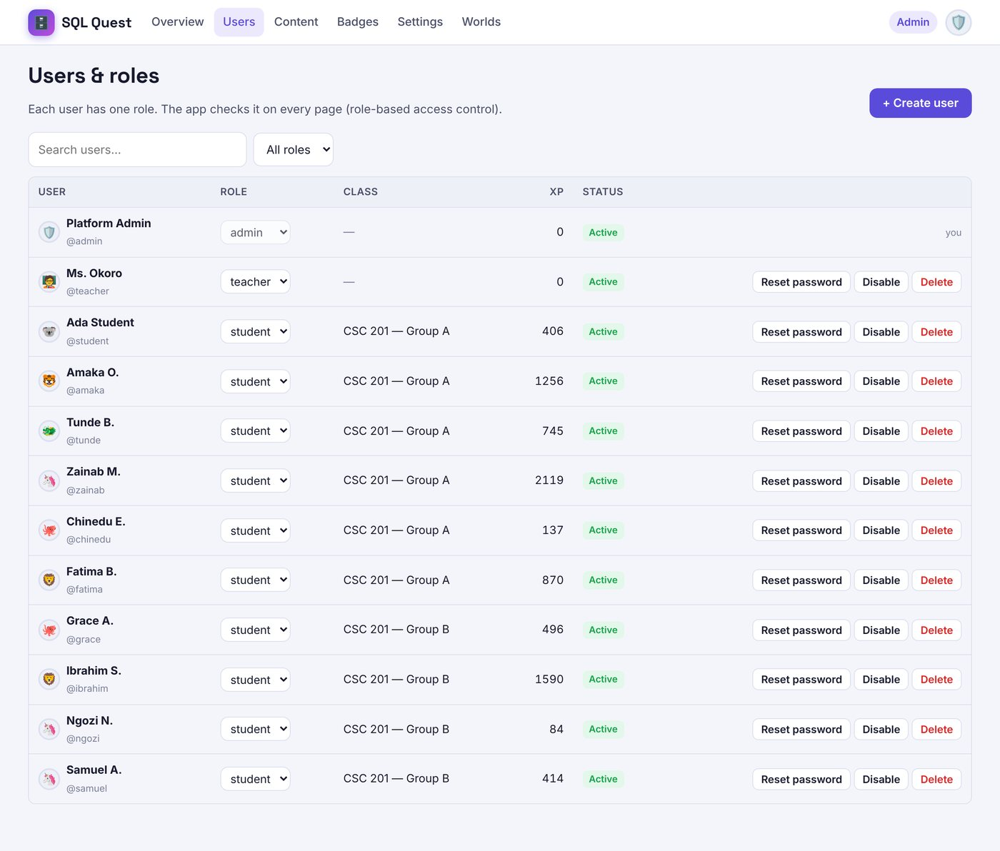
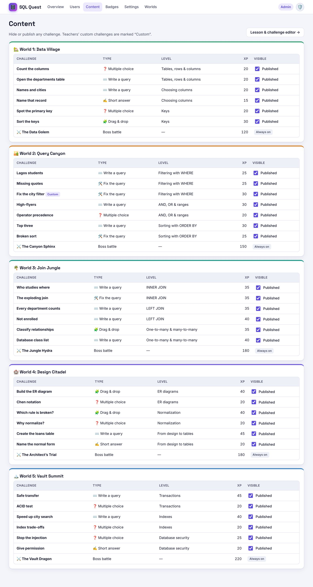
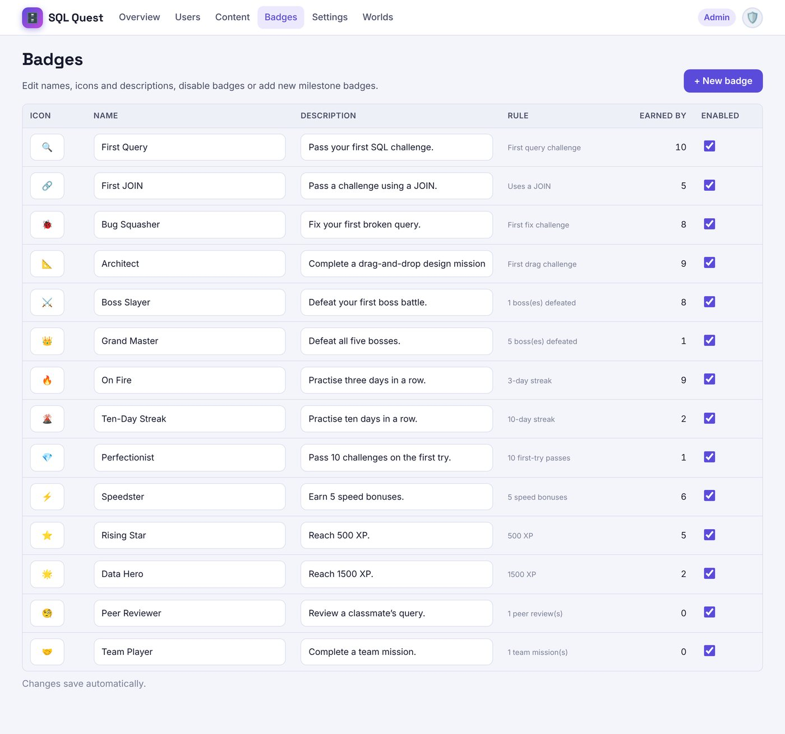
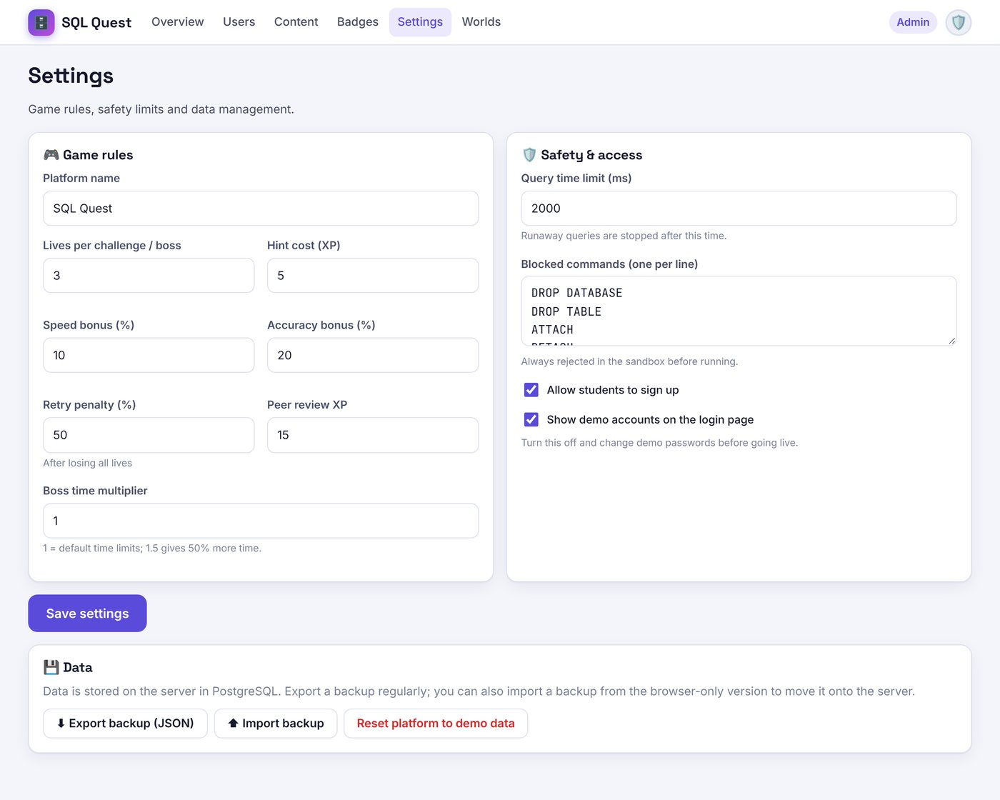

# SQL Quest — Administrator Guide

Administrators manage accounts and roles, decide which content is visible, configure badges and game rules, and look
after backups. To install or update the platform itself, see the [Installation Guide](INSTALLATION-GUIDE.md).

---

## 1. Roles

Every account has exactly one role. In the server version the server checks the role on **every request**, so nobody can
use features outside their role.

| | Student | Teacher | Admin |
|---|:-:|:-:|:-:|
| Lessons, challenges, bosses, XP, badges | ✅ | preview | preview |
| Join a class, peer review, team missions | ✅ | | |
| See own progress | ✅ | ✅ | ✅ |
| Create classes, assignments, teams | | ✅ own classes | ✅ all |
| Class analytics and student progress | | ✅ own classes | ✅ all |
| Create lessons and challenges | | ✅ own | ✅ all |
| Manage users and roles, reset passwords | | | ✅ |
| Hide/publish any challenge, badges, settings, backups | | | ✅ |

Students never see other students' answers or private details. Leaderboards show only display name, avatar, XP, level,
streak and badge count.

---

## 2. First steps on a new installation

1. Log in with the admin username and password set during installation (`ADMIN_USERNAME` / `ADMIN_PASSWORD`).
2. Account menu → **Profile & settings** → **Change password**.
3. **Settings**: check that **Show demo accounts on the login page** is off, and decide whether to **Allow students to sign up**.
4. **Users** → **+ Create user** for each teacher (role *teacher*, with a temporary password they change at first login).

If the platform was started with demo data (`SEED_DEMO=true`), delete the demo accounts or start again with an empty
database before real use. The demo passwords are public.

---

## 3. Users and roles

**Users** lists every account. Use the search box and role filter to find people.

| Action | Effect |
|---|---|
| **Role** drop-down | Changes the role immediately. You can't change your own role, so there is always at least one admin. |
| **Reset password** | Sets a new password and signs the user out everywhere. Tell them the new password; they can change it in their profile. |
| **Disable / Enable** | A disabled account can't log in and is signed out at once. Its data is kept. |
| **Delete** | Permanently removes the account, its progress, submissions, badges and shared queries. Classes it taught are moved to you. **This can't be undone**; export a backup first if unsure. |
| **+ Create user** | Creates an account with any role. |

---

## 4. Content

**Content** lists every challenge in every world, including teachers' custom ones (marked *Custom*).
Untick **Visible** to hide a challenge from students; tick it again to publish. Boss battles are always on.
To write or edit content, use **Lesson & challenge editor →** (the same editor teachers use).

---

## 5. Badges

**Badges** lets you change each badge's **icon** (an emoji), **name** and **description**, and switch it on or off.
Changes save as soon as you leave the field.

**+ New badge** creates a milestone badge awarded automatically when a student reaches a value of: XP, challenges
completed, best streak, bosses defeated, first-try passes or peer reviews given. Students who already qualify receive it
straight away.

---

## 6. Settings

**Game rules**

| Setting | Default | Meaning |
|---|---|---|
| Platform name | SQL Quest | Shown in the top bar and on the login page. |
| Lives per challenge / boss | 3 | Wrong answers allowed before "Out of lives". |
| Hint cost (XP) | 5 | XP taken for each hint. |
| Speed bonus (%) | 10 | Extra XP for passing within the par time. |
| Accuracy bonus (%) | 20 | Extra XP for passing with no wrong attempts. |
| Retry penalty (%) | 50 | XP removed if the student lost all lives before passing. |
| Peer review XP | 15 | XP for each review written. |
| Boss time multiplier | 1 | 1.5 gives 50% more time in every boss battle; useful for younger or newer classes. |

**Safety and access**

| Setting | Default | Meaning |
|---|---|---|
| Query time limit (ms) | 2000 | Queries running longer are stopped. |
| Blocked commands | DROP DATABASE, DROP TABLE, ATTACH, DETACH, PRAGMA, VACUUM, LOAD_EXTENSION, TRUNCATE | Always refused before running. |
| Allow students to sign up | on | Off = only admins create accounts. |
| Show demo accounts on the login page | off on new servers | Turn **off** on any real site. |

Every query runs in a brand-new copy of a small practice database, so even allowed statements can't affect real data.

---

## 7. Backups and moving data

At the bottom of **Settings**:

- **⬇ Export backup (JSON)** downloads everything: accounts (with securely hashed passwords), progress, classes,
  custom content and settings. Keep it somewhere safe; it contains personal data.
- **⬆ Import backup** **replaces all current data** with a backup file. Everyone is signed out afterwards.
- **Moving from the browser-only version to the server:** export a backup in the browser version, log in to the server
  as admin, and import it. Passwords keep working and are upgraded to stronger hashing at each user's next login.
- **Reset platform to demo data** only appears when the server allows it (`ALLOW_DEMO_RESET=true`). Never enable it on a live site.

For a server, also back up the PostgreSQL database regularly (see the Installation Guide, section 6).

---

## 8. Security checklist

- [ ] Strong, unique admin password; at least two admin accounts in case one is locked out.
- [ ] Demo accounts hidden and deleted (or never seeded).
- [ ] Site served over **HTTPS**, with `COOKIE_SECURE=true` and `TRUST_PROXY=true` behind a proxy.
- [ ] `ALLOW_DEMO_RESET` left off.
- [ ] Regular database backups, stored securely.
- [ ] Disable accounts of people who leave.

Built-in protections: scrypt password hashing, HTTP-only session cookies, rate limits on login and sign-up (repeated
failures are blocked for 15 minutes), checks against cross-site requests, answers never sent to browsers, and
server-side marking.

---

## 9. Troubleshooting

| Problem | Fix |
|---|---|
| "Too many attempts" at login | Wait 15 minutes. Repeated failed logins are blocked for that time. |
| A user can't log in | Check they are **Enabled** in Users; reset their password. |
| "Could not save your change" | The database could not be reached. Check that PostgreSQL is running; the change is kept and retried on the next save. |
| Students see "The SQL Quest server is not responding" | The server process or database is down. Check the server logs (`docker compose logs app`). |
| Locked out of every admin account | Someone with server access **stops the app** and runs `node server/scripts/reset-password.js <username> <new-password> --make-admin` with the same `DATABASE_URL`, then starts the app again (with Docker: `docker compose stop app`, then `docker compose run --rm app node server/scripts/reset-password.js admin NewPass123 --make-admin`, then `docker compose start app`). Prevent this by keeping two admin accounts. |
