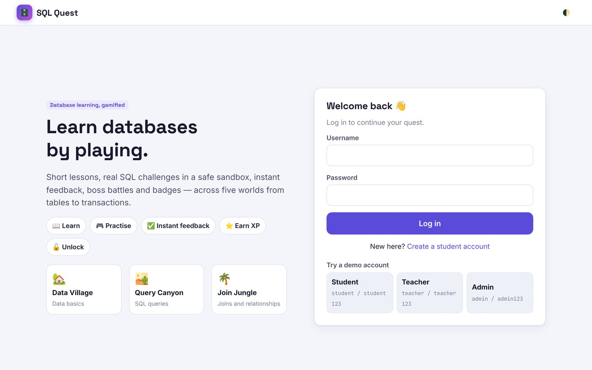
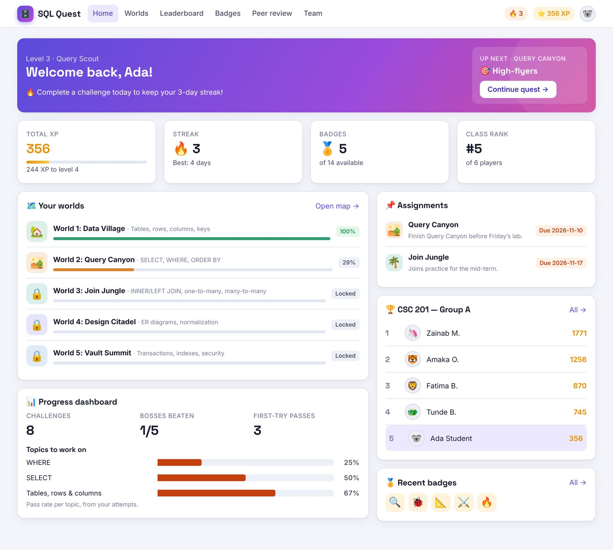
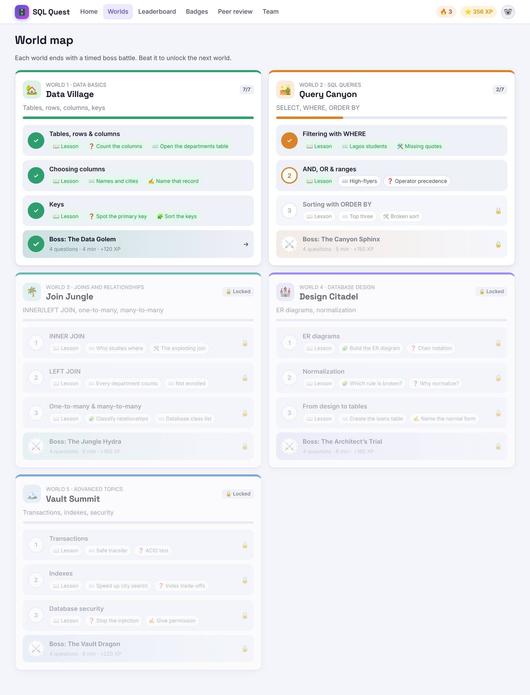
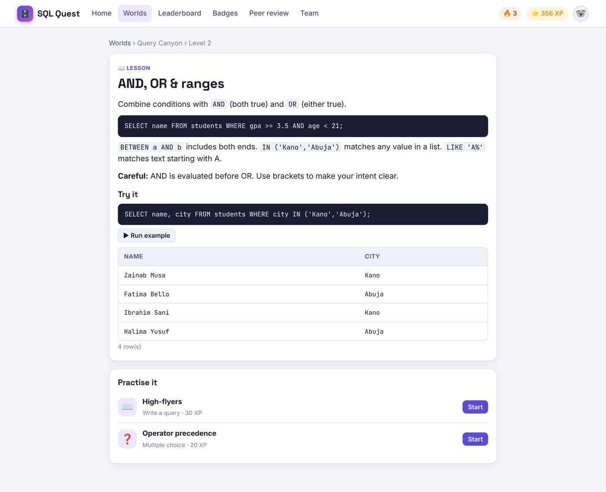
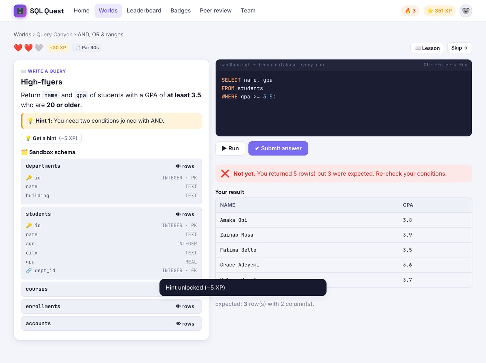
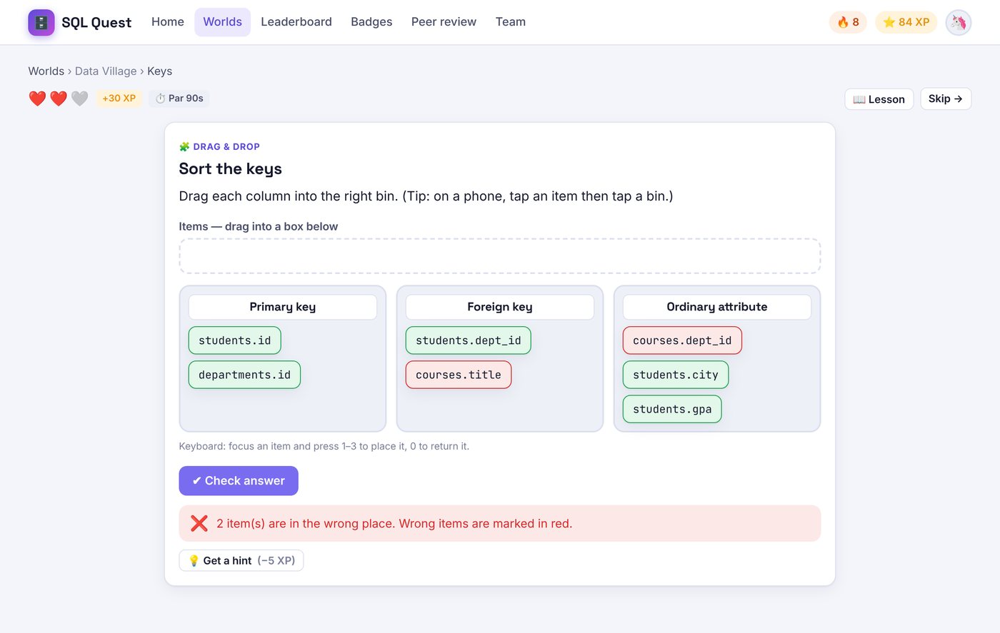
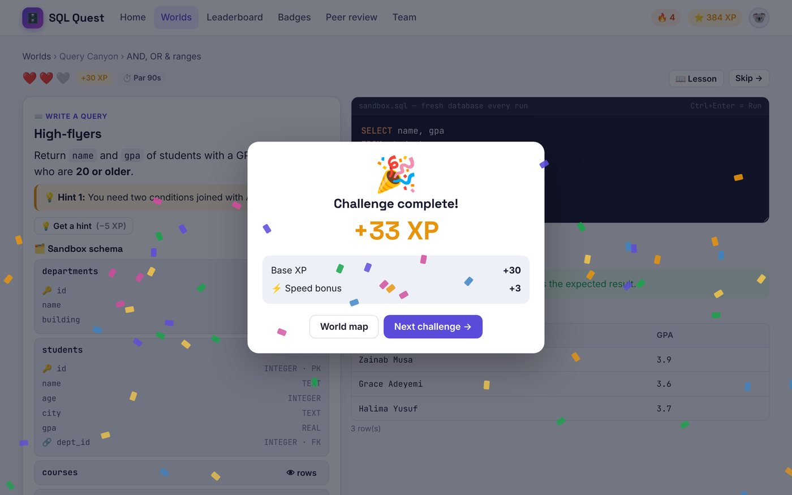
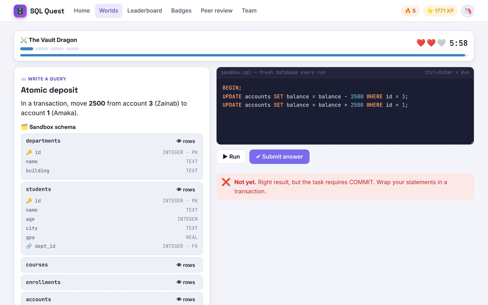

# SQL Quest — Student Guide

SQL Quest teaches you databases by playing. You read a short **lesson**, try a **challenge**, get **instant feedback**,
earn **XP** and **badges**, and unlock the next level. Each world ends with a timed **boss battle**.

---

## 1. Getting started

### Create your account
1. Open the SQL Quest web address your teacher gave you.
2. Click **Create a student account**.
3. Fill in your **display name** (what classmates see), a **username** (3–24 letters or numbers) and a **password** (at least 6 characters).
4. Type the **class join code** from your teacher, for example `DBQ-201`. You can skip this and join later.
5. Click **Create account**. You're in!

> If sign-up is turned off, your teacher or administrator will give you a username and password instead.

### Log in
Enter your username and password and click **Log in**. You stay logged in on that device until you log out
(account menu → **Log out**).

### Join a class later
On your **Home** page, use the **Join your class** box, or go to the account menu → **Profile & settings** → **Class**.
Joining a class lets you see your teacher's **assignments**, the **class leaderboard**, **peer review** and **team missions**.

---

## 2. Your home page (dashboard)

| Area | What it shows |
|---|---|
| **Welcome banner** | Your level and title, and whether today's practice has kept your streak alive. |
| **Up next** | The next lesson, challenge or boss. Click **Continue quest →** to go straight there. |
| **Total XP** | Your points, plus how many more you need for the next level. |
| **Streak** | How many days in a row you have practised, and your best streak. |
| **Badges** | How many badges you have earned. |
| **Class rank** | Your position on your class leaderboard. |
| **Your worlds** | Progress bars for the five worlds. 🔒 means locked. |
| **Progress dashboard** | Challenges done, bosses beaten, first-try passes, and **Topics to work on**: the topics where you fail most often. |
| **Assignments** | Worlds your teacher has set, with due dates. |
| **Leaderboard / Recent badges** | Your class top 5 and your latest badges. |

---

## 3. The world map

Click **Worlds** in the top menu.

There are five worlds, in order:

| World | Topics |
|---|---|
| 🏡 1. Data Village | Tables, rows, columns, keys |
| 🏜️ 2. Query Canyon | SELECT, WHERE, ORDER BY |
| 🌴 3. Join Jungle | INNER JOIN, LEFT JOIN, one-to-many, many-to-many |
| 🏰 4. Design Citadel | ER diagrams, normalization, CREATE TABLE |
| 🏔️ 5. Vault Summit | Transactions, indexes, security |

Each world has **3 levels**. Each level has a **📖 lesson** and **2 challenges**. After the three levels comes the **⚔️ boss**.

**How things unlock**
- Finish both challenges in a level to unlock the next level.
- Finish every level in a world to wake the boss.
- Beat the boss to unlock the next world.
- Your teacher can also unlock a world early by assigning it.

Challenges marked **⭐** are **bonus challenges** added by your teacher. They earn XP but are optional: they never lock you out of anything.

---

## 4. Lessons

A lesson explains one idea with short examples. Click **▶ Run example** to see the example query's result.
At the bottom, **Practise it** lists the level's challenges.

---

## 5. Challenges

There are five kinds of challenge:

| Icon | Type | What you do |
|---|---|---|
| ⌨️ | **Write a query** | Write SQL that returns the requested result. |
| 🛠️ | **Fix the query** | A broken query is given. Repair it. |
| ❓ | **Multiple choice** | Pick one answer, then click **Check answer**. |
| ✍️ | **Short answer** | Type a word or short phrase. Capital letters don't matter. |
| 🧩 | **Drag & drop** | Drag each item into the right box: keys, relationships, ER diagrams, normal forms. |

### The SQL editor

- **▶ Run** (or **Ctrl + Enter**) shows your result. It does **not** count as an attempt and never costs a life. Run as often as you like.
- **✔ Submit answer** sends your answer to be marked. A wrong answer costs a ❤️ life.
- **↺ Reset** (in "Fix the query" challenges) brings the broken query back.
- **🗂️ Sandbox schema** (left) lists every table and column. 🔑 marks a primary key and 🔗 a foreign key. Click **👁 rows** to see the data.
- The practice database is **reset every time you run**, so you can't break anything.

### Feedback
After you submit, a message tells you what's wrong, for example:

| Message | What to check |
|---|---|
| *You returned 12 row(s) but 3 were expected* | Your WHERE conditions. |
| *this question needs a WHERE filter* | You forgot to filter rows. |
| *Missing JOIN condition* | Add `ON a.column = b.column` to your JOIN. |
| *should this be a LEFT JOIN?* | INNER JOIN drops rows with no match. |
| *Right rows, wrong order* | Your `ORDER BY` column, or ASC/DESC. |
| *no such column: Lagos* | Text needs single quotes: `'Lagos'`. |
| *different number of columns* | Return exactly the columns asked for, no more and no fewer. |

You also see **Expected: N row(s) with M column(s)** so you know what to aim for.
Row order doesn't matter unless the question asks you to sort.

### Lives and retries
You have **3 lives ❤️❤️❤️** per challenge. If you lose them all, you can **📖 Review the lesson** or **↺ Retry**.
A retry after losing all lives earns **half the normal XP**.

### Hints
Click **💡 Get a hint** to see a tip. Each hint **costs 5 XP**. Hints you have bought stay visible if you come back.

### Drag & drop on a phone
**Tap** an item, then **tap** the box it belongs in. Items marked red after checking are in the wrong box.

---

## 6. XP, levels and bonuses

When you pass a challenge for the first time you earn:

| | |
|---|---|
| **Base XP** | Shown on the challenge (for example +30 XP). |
| **⚡ Speed bonus** | +10% if you finish within the **par time** (shown as ⏱️ Par). |
| **🎯 Accuracy bonus** | +20% if you had **no wrong attempts**. |
| **↺ Retry penalty** | −50% if you had lost all your lives before passing. |

Replaying a finished challenge is good practice but earns no extra XP.
Level titles go from *Novice* → *Apprentice* → *Query Scout* → *Data Ranger* → *Join Knight* → *Schema Sage* → *Index Wizard* → *Vault Keeper* → *DB Legend*.

---

## 7. Boss battles ⚔️

- A boss has **4 questions** that mix everything from its world.
- You have a **time limit** (4–6 minutes) and **3 lives** for the whole battle.
- **No hints!**
- A wrong answer costs a life. You can try the same question again.
- Win to earn the boss XP **plus a time bonus and a bonus for lives left**, and to unlock the next world.
- If time or lives run out, review the lessons and **Try again**. The boss resets fully.

---

## 8. Streaks and badges

**Streak 🔥:** every day, pass at least one *new* challenge, beat a boss, or give a peer review. Replays don't count.
Missing a day resets the streak to 0.

> The numbers in this guide (3 lives, 5 XP per hint, +10% / +20% bonuses) are the defaults. Your administrator can change them.

**Badges 🏅** are awarded automatically. Open **Badges** to see them all, including the locked ones. Examples:

| | Badge | How to earn it |
|---|---|---|
| 🔍 | First Query | Pass your first SQL challenge |
| 🔗 | First JOIN | Pass a challenge using a JOIN |
| 🐞 | Bug Squasher | Fix your first broken query |
| 📐 | Architect | Complete a drag-and-drop design mission |
| ⚔️ | Boss Slayer | Defeat your first boss |
| 👑 | Grand Master | Defeat all five bosses |
| 🔥 / 🌋 | On Fire / Ten-Day Streak | Practise 3 / 10 days in a row |
| 💎 | Perfectionist | Pass 10 challenges on the first try |
| 🧐 | Peer Reviewer | Review a classmate's query |
| 🤝 | Team Player | Complete a team mission |

---

## 9. Leaderboard

**Leaderboard** shows your **class** ranking and the **global** ranking by XP, with a podium for the top three.
Your row is highlighted.

---

## 10. Peer review 🧐

Open **Peer review**.

- **Share a query:** pick a SQL challenge you have passed, add an optional question, and click **Share**. Classmates see it **anonymously** ("Classmate #3").
- **Review classmates:** read a classmate's query, give 1–5 ⭐ and written feedback. You earn **+15 XP** for each review (once per query).
- **My shared queries:** read the feedback you received.

Only queries you choose to share are visible. Nobody can see your other answers.

---

## 11. Team missions 🤝

If your teacher puts you in a team, open **Team**.

- Every member can write a draft and click **💾 Save team draft** so the others can see it.
- Only the **👑 team leader** can **Submit**.
- When the leader passes, **every member** earns the XP and the **Team Player** badge.

---

## 12. Profile and settings

Account menu (your avatar, top right) → **Profile & settings**:

- change your **display name** and **avatar**
- **join or switch class**
- **change your password**
- see your **4-week activity** calendar

**🌓 Toggle dark mode** is in the same menu.

---

## 13. Questions and problems

**I forgot my password.** Ask your teacher or administrator to reset it.

**A world or level shows 🔒.** Finish the earlier level or boss first, or ask your teacher to assign the world.

**My query works when I click Run, but Submit says it's wrong.** Run only shows your result. Compare it with the question:
check the columns, the filter, the sort order and the number of rows.

**"Blocked command".** Commands like `DROP TABLE` are not allowed in the sandbox. Use the statements the question asks for.

**"Time limit exceeded".** Your query ran too long (often an endless loop or a JOIN with no ON). Simplify it.

**My progress disappeared.** If your school runs the *browser-only* version, progress is saved only in the browser and
device you used. Use the same device and browser, and don't clear browsing data. On the *server* version, progress is
saved online and follows you to any device.
