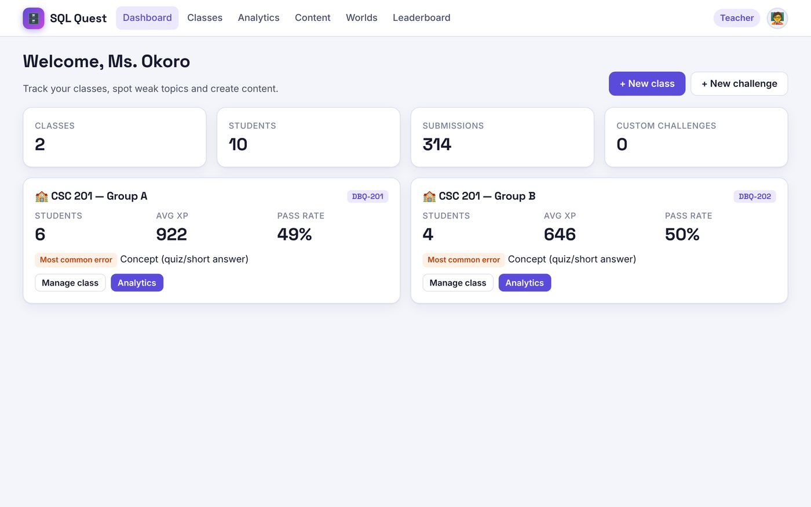
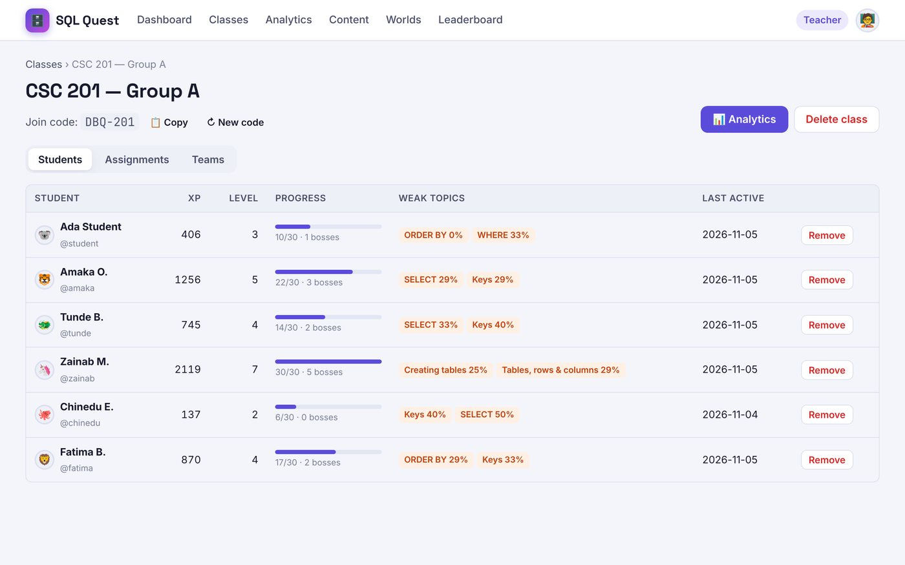
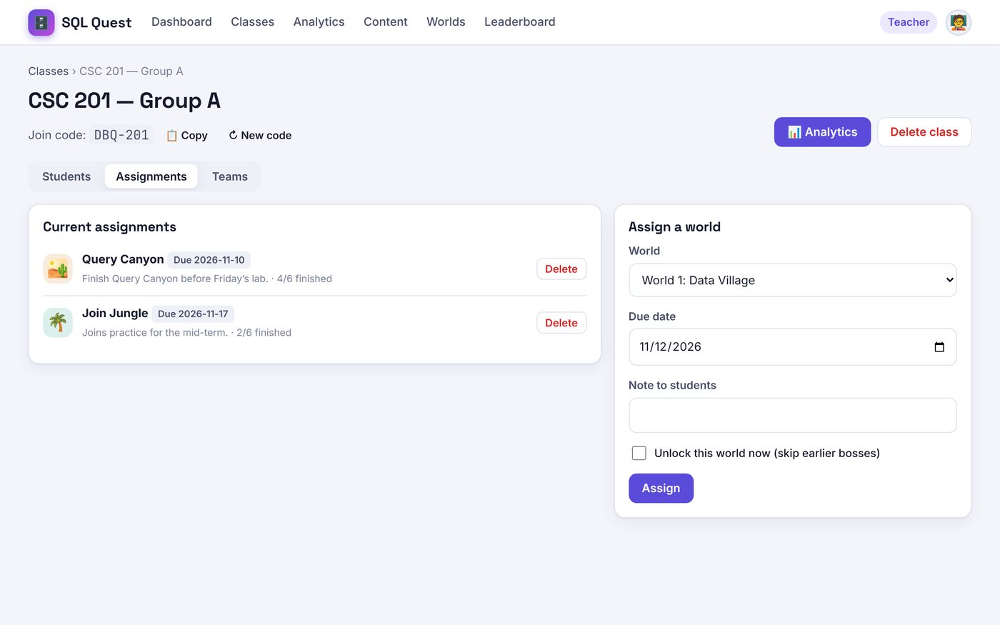
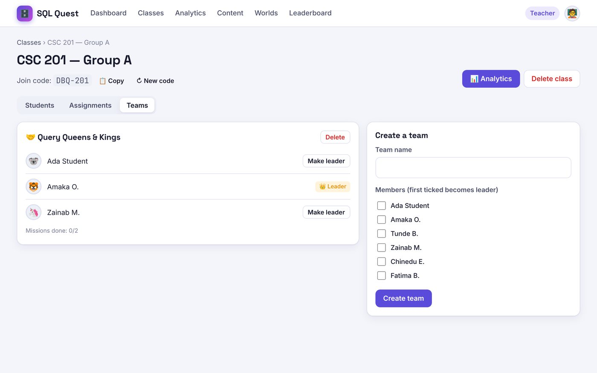
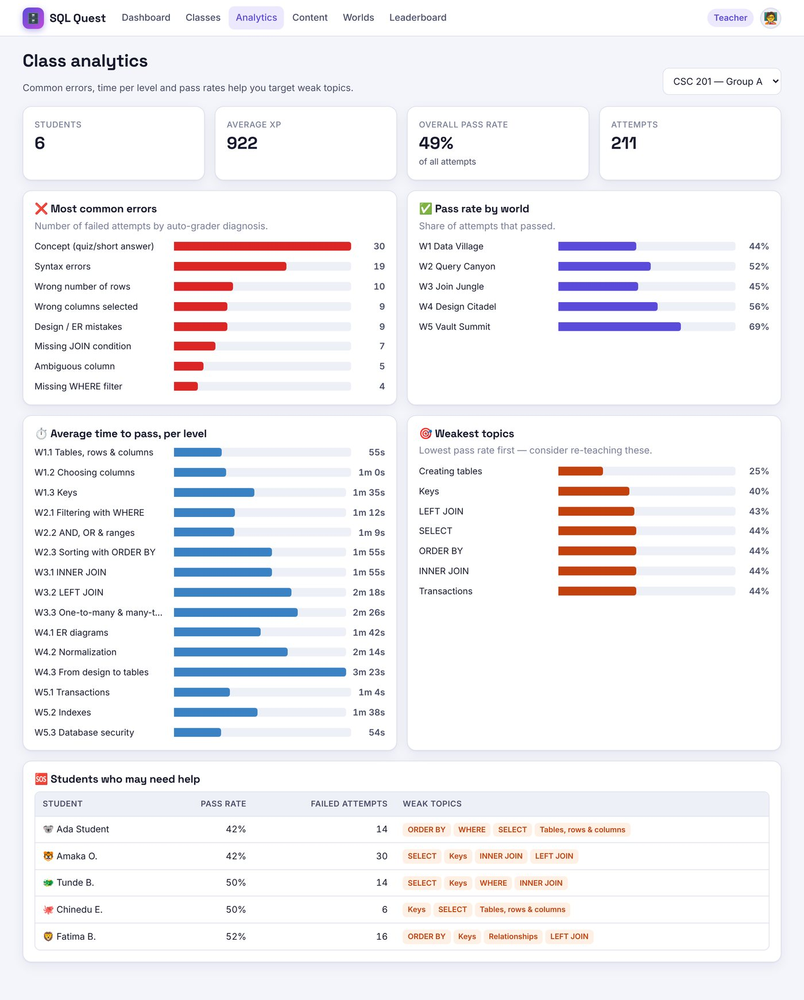
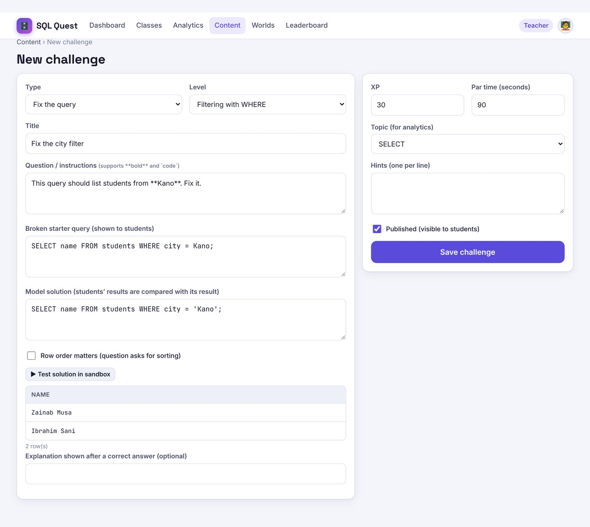
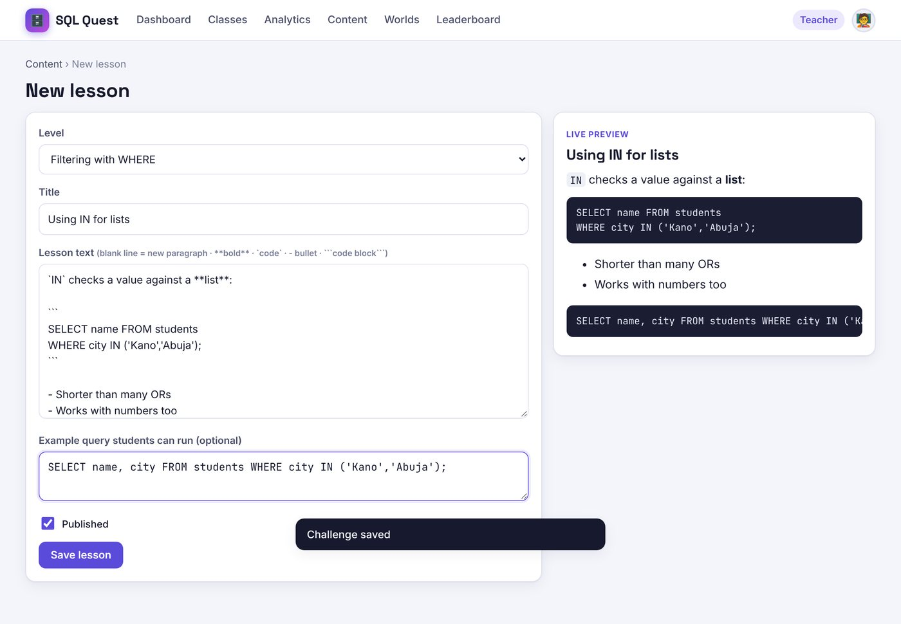

# SQL Quest — Teacher Guide

As a teacher you can create classes, give students a join code, assign worlds with due dates, form teams, follow
progress with analytics, and write your own lessons and challenges.

---

## 1. Your account

Teacher accounts are created by an **administrator** (students cannot sign up as teachers). Log in with the username
and password you were given, then change your password: account menu (top right) → **Profile & settings** → **Change password**.

Your top menu: **Dashboard · Classes · Analytics · Content · Worlds · Leaderboard**.



The **Dashboard** shows each class with its join code, number of students, average XP, pass rate and most common error.

---

## 2. Classes and join codes

1. Click **+ New class**, type a name (for example *CSC 201 — Group A*) and click **Save**.
2. SQL Quest creates a **join code** such as `K7P-Q2M`.
3. Give the code to your students. They type it when they sign up, or later under **Join your class** on their home page.

On a class page:
- **📋 Copy** copies the code.
- **↻ New code** replaces it. Students already in the class stay; the old code stops working.
- **Delete class** removes the class with its assignments, teams and shared peer-review queries. Students keep their accounts and progress.

### Students tab



For each student: XP, level, overall progress, bosses beaten, **weak topics** (topics where their pass rate is below 70%)
and the date they were last active. **Remove** takes a student out of the class without deleting their account.

---

## 3. Assignments

Open a class → **Assignments**.

1. Choose a **World**, a **Due date** and an optional **Note to students**.
2. Tick **Unlock this world now** if students should start it before beating the earlier bosses. This is useful for
   revision or for students who join late.
3. Click **Assign**.

Students see assignments on their home page, marked *Done* when they finish the world. The list here shows how many
students have finished each one.



---

## 4. Teams

Open a class → **Teams**.

1. Type a **team name**, tick at least two students, and click **Create team**. The **first student ticked becomes the
   team leader**. A student can only be in one team; ticking them moves them out of any other team.
2. Click **Make leader** to change the leader.

In **Team missions**, every member can write and save drafts, but **only the leader can submit**. When the leader
passes, every member earns the XP.



---

## 5. Analytics

Click **Analytics** and pick a class at the top right.



| Panel | What it tells you | What to do |
|---|---|---|
| **Students / Average XP / Overall pass rate / Attempts** | Class activity at a glance. | A low pass rate with many attempts means the class is struggling. |
| **❌ Most common errors** | Failed attempts grouped by what the auto-grader found: *Missing JOIN condition*, *Missing WHERE filter*, *Syntax errors*, *Unknown table/column (often missing quotes)*, … | Re-teach the top one or two at the start of the next lesson. |
| **✅ Pass rate by world** | Share of attempts that passed in each world. | A sudden drop shows where the class hit a wall. |
| **⏱️ Average time to pass, per level** | How long students take to pass each level. | Long times point to topics that need more examples. |
| **🎯 Weakest topics** | Topics with the lowest pass rate. | Make a bonus challenge on that topic (see section 6). |
| **🆘 Students who may need help** | The five students with the lowest pass rates, with their weak topics. | Check in with them individually. |

---

## 6. Your own content

Click **Content**. Everything you create appears inside the level you choose, for all students.

### New challenge
Click **+ New challenge**.



| Field | Notes |
|---|---|
| **Type** | *Write a query*, *Fix the query*, *Multiple choice* or *Short answer*. |
| **Level** | Where it appears. |
| **Title / Question** | The question can use `**bold**` and `` `code` ``. |
| **Broken starter query** | Fix-the-query only: what students start with. |
| **Model solution** | Query challenges only. Write a correct `SELECT`; the grader runs it to get the expected result. Students' results are compared with it, so you never type the answer table yourself. Click **▶ Test solution in sandbox** to check it. |
| **Row order matters** | Tick only if the question asks for sorting. Otherwise any row order is accepted. |
| **Options** | Multiple choice: fill 2–4 options and select the correct one. |
| **Accepted answers** | Short answer: comma-separated, not case sensitive (for example `row, record, tuple`). |
| **XP / Par time** | Points, and the time limit for the ⚡ speed bonus. |
| **Topic** | Used by analytics. |
| **Hints** | One per line. Students pay XP to see them. |
| **Published** | Untick to keep it as a draft. |

Your challenges show as **⭐ Bonus** for students. They earn XP but are **optional**, so adding one never locks
students out of levels they have already reached.

### New lesson
Click **+ New lesson**, choose the level, write the text and an optional **example query** that students can run.
Formatting: a blank line starts a new paragraph; `**bold**`, `` `code` ``, `- ` for bullet points, and three back-ticks
(```) around a block of code. The **Live preview** shows the result as you type.



### Editing
The **Content** page lists your challenges and lessons with **Preview**, **Edit** and **Delete**. You can only edit
content you created (administrators can edit anything).

---

## 7. Previewing the game

Click **Worlds** to see everything students see. **Staff accounts have every world unlocked** so you can try any
challenge or boss. Boss battles and practice don't put you on the leaderboard (only students are ranked).

---

## 8. A suggested way to run it

| When | Activity |
|---|---|
| Week 1 | Create the class, share the join code, students sign up and play **World 1** in the lab. |
| Each week | Assign the next world with a due date. Open a lesson with the **Most common errors** panel from Analytics. |
| Mid-term | Assign **Join Jungle** with *Unlock* ticked for revision. Make a ⭐ bonus challenge on the weakest topic. |
| Ongoing | Use **Teams** for group work and encourage **Peer review**: reviewers earn XP and both sides learn. |

---

## 9. Questions

**A student forgot their password.** Ask an administrator to reset it (Admin → Users → **Reset password**).

**A student can't open a world.** They must beat the previous boss. To skip that, assign the world with **Unlock this world now** ticked.

**Can students cheat by looking at the page code?** On the **server** version, answers never reach the browser and every
answer is marked on the server. On the browser-only version a determined student could find answers, so use the server
version for anything that counts towards grades.

**Where is my data stored?** On the server version, in the school's PostgreSQL database. On the browser-only version,
only in the browser you are using.
