# SQL Quest — a gamified database learning platform

SQL Quest teaches database concepts to computer-education students through play:
**learn** a short lesson → **practise** in a game challenge → get **instant feedback** from the auto-grader →
**earn** XP, badges and streak points → **unlock** the next level.

It is a complete static web app (HTML + CSS + JavaScript). Students run **real SQL** against a real
SQLite database compiled to WebAssembly ([sql.js](https://github.com/sql-js/sql.js), included in `vendor/`), so no server is needed.

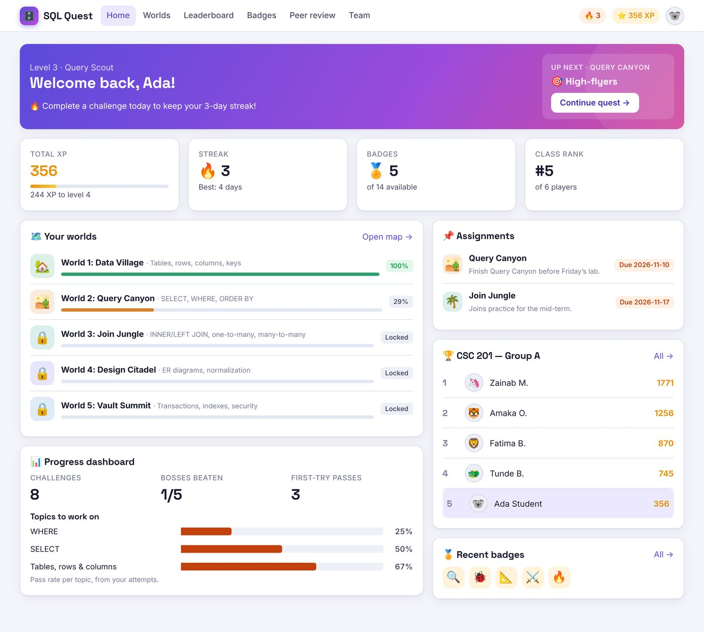

## Two ways to run it

| | **Server version** (recommended for classes) | **Browser-only version** |
|---|---|---|
| Run | `docker compose up -d` from the repository root (Node.js + PostgreSQL) | Upload this `sql-quest/` folder to any static host |
| Data | PostgreSQL, shared by all devices | Each visitor's browser |
| Marking | On the server; answers never reach the browser | In the browser |

The same files power both; the page detects which one it is in. Step-by-step instructions are in the
[Installation Guide](../docs/INSTALLATION-GUIDE.md).

**Browser-only quick start:** upload the contents of this folder (or `sql-quest-upload.zip`) to Netlify, GitHub Pages,
cPanel, etc. Open it through a web address, not by double-clicking `index.html`. Locally: `python3 -m http.server 8000`.

## User guides

- [Student Guide](../docs/STUDENT-GUIDE.md) ([PDF](../docs/SQL-Quest-STUDENT-GUIDE.pdf))
- [Teacher Guide](../docs/TEACHER-GUIDE.md) ([PDF](../docs/SQL-Quest-TEACHER-GUIDE.pdf))
- [Administrator Guide](../docs/ADMIN-GUIDE.md) ([PDF](../docs/SQL-Quest-ADMIN-GUIDE.pdf))
- [Installation Guide](../docs/INSTALLATION-GUIDE.md) ([PDF](../docs/SQL-Quest-INSTALLATION-GUIDE.pdf))

A short role-specific guide is also built into the app: account menu → **❓ Help**.

### Demo accounts

| Role | Username | Password |
|---|---|---|
| Student | `student` | `student123` |
| Teacher | `teacher` | `teacher123` |
| Admin | `admin` | `admin123` |

These are created automatically in browser-only mode, and on the server only when it is started with `SEED_DEMO=true`.
Nine more demo students (`amaka`, `tunde`, `zainab`, `chinedu`, `fatima`, `grace`, `ibrahim`, `ngozi`, `samuel`, password `student123`)
have progress already, so leaderboards and analytics show data. Demo class codes are **DBQ-201** and **DBQ-202**.

**Before going live:** log in as admin → **Settings** → untick “Show demo accounts”, and change the admin password
(Profile → Change password). Admin → Settings → “Reset platform to demo data” restores everything.

## What's included (mapped to the design document)

| Design document | Implemented |
|---|---|
| Core loop | Lesson → challenge → instant feedback → XP/badges/streak → unlock |
| 5 Worlds | Data Village (tables, rows, columns, keys) · Query Canyon (SELECT, WHERE, ORDER BY) · Join Jungle (INNER/LEFT JOIN, 1:N, M:N) · Design Citadel (ER diagrams, normalization) · Vault Summit (transactions, indexes, security) |
| Boss battles | A timed boss at the end of each world: 4 questions, shared lives, time & lives bonuses |
| XP & levels | XP per challenge plus speed and accuracy bonuses; 9 level titles |
| Badges | 14 badges (First Query, First JOIN, Ten-Day Streak, Boss Slayer, …); admins can edit them or add more |
| Daily streaks | Consecutive-day tracking, best streak, 4-week activity calendar |
| Leaderboards | Class and global rankings with a podium |
| Lives & hints | 3 lives per challenge (retry after losing all lives = reduced XP); hints cost XP |
| Mission types | Write a query · Fix a broken query · Drag & drop (ER diagram, keys, relationships, normal forms) · Multiple choice · Short answer |
| Sandbox database | A fresh SQLite database for every run (reset after each challenge), running in a Web Worker |
| Auto-grader | Compares your result set with the model solution's result. Accepts any row order unless sorting is required, columns in a different order, aliases, and comma joins. Checks the database state after INSERT/UPDATE/CREATE scripts. Gives targeted feedback (missing JOIN condition, INNER vs LEFT, missing WHERE/LIMIT, wrong ORDER BY, unquoted text, …) |
| Student role | Register, join a class by code, lessons, challenges, hints, retries, progress dashboard with weak topics, leaderboard |
| Team sub-roles | Team missions: members draft together, the **team leader** submits, every member earns XP. **Peer reviewers** rate a classmate's shared query anonymously for bonus XP |
| Teacher role | Create classes with join codes, assign worlds (with due date and optional early unlock), manage teams, analytics, create and edit lessons and challenges |
| Admin role | Manage users and roles, reset passwords, disable or delete accounts, publish or hide any challenge, configure badges, platform settings, backup export/import |
| Analytics | Most common errors, pass rate by world, average time per level, weakest topics, students who may need help |
| Safety | Blocked commands (DROP TABLE/DATABASE, ATTACH, PRAGMA, …; admins can change the list), per-challenge allowed statement types, query time limit (runaway queries are stopped), salted + hashed passwords, role check on every page |
| Responsive | Works on phones and desktops, with light and dark mode |
| Server | Node.js API, PostgreSQL storage, server-side marking in sandboxed worker threads, scrypt passwords, HTTP-only sessions, login rate limiting, Docker setup |

## Where data is stored

- **Server version:** in PostgreSQL. Every change goes through the server, which checks the user's role, marks answers
  in its own sandbox and stores the result. Students receive the game content with answers removed.
- **Browser-only version:** in each browser's local storage. That's convenient for demos and self-study, but data isn't
  shared between devices, and a determined student could read the answers in the page code.

The rules live in one place, `js/actions.js` (with `engine.js` and `grader.js`). The browser runs them in browser-only
mode, and the server runs **the same files** in server mode. Admins can move data from browser-only to the server with
Settings → Export / Import backup.

## Project structure

```
sql-quest/
├── index.html             App shell
├── css/style.css          Styles (light and dark themes, responsive)
├── js/content.js          Curriculum: sandbox data, 5 worlds, lessons, 30 challenges, 5 bosses, badges, team missions
├── js/store.js            Data access over the current data set (shared with the server)
├── js/actions.js          Every change to data: role checks, grading, XP (shared with the server)
├── js/backend.js          Chooses server mode (API) or browser-only mode (localStorage)
├── js/help.js             In-app help page
├── js/engine.js           Unlocking, XP, levels, badges, analytics
├── js/grader.js           Sandbox runner (Web Worker + time limit) and auto-grader
├── js/sandbox-worker.js   Runs each query in a fresh SQLite database
├── js/app.js              Router with role checks, login, student screens
├── js/play.js             Challenge player, boss battles, team missions
├── js/teacher.js          Classes, assignments, teams, analytics, content editor
├── js/admin.js            Users, content, badges, settings
├── vendor/                sql.js 1.10.3 (SQLite → WebAssembly, MIT licence)
└── screenshots/           Sample of every screen
```

## Adding content

- **Without code:** log in as a teacher → **Content** → *New challenge* / *New lesson*. Use “Test solution” to preview the result.
- **In code:** add challenges to `SQ.WORLDS` in `js/content.js`. For a `query`/`fix` challenge you only write the
  model `solution`; the grader runs it to get the expected result.

## Screens

| | |
|---|---|
| 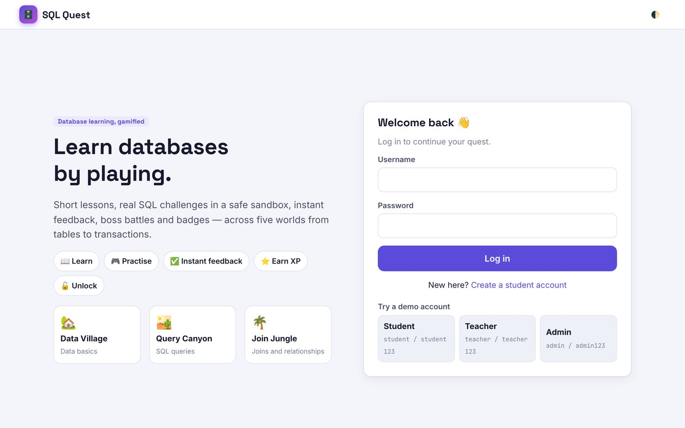 Login | 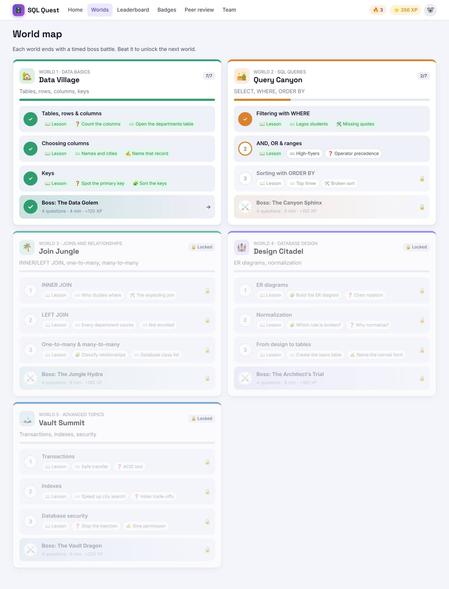 World map |
| 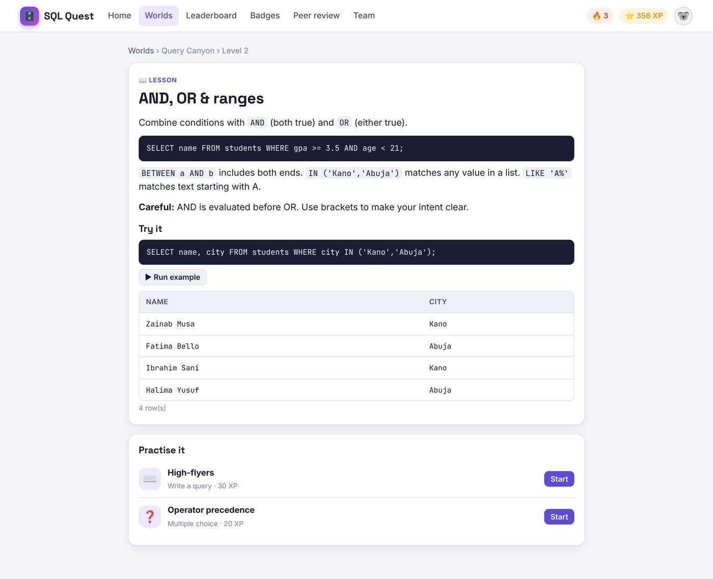 Lesson | 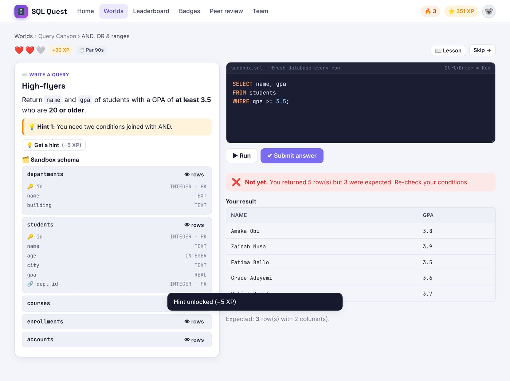 SQL challenge with feedback |
| 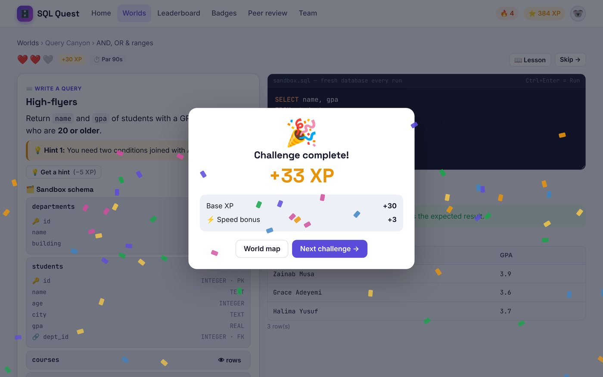 Reward | 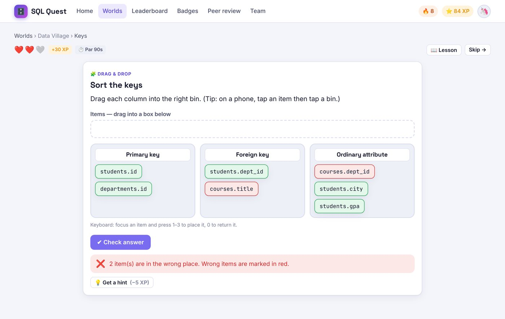 Drag & drop |
| 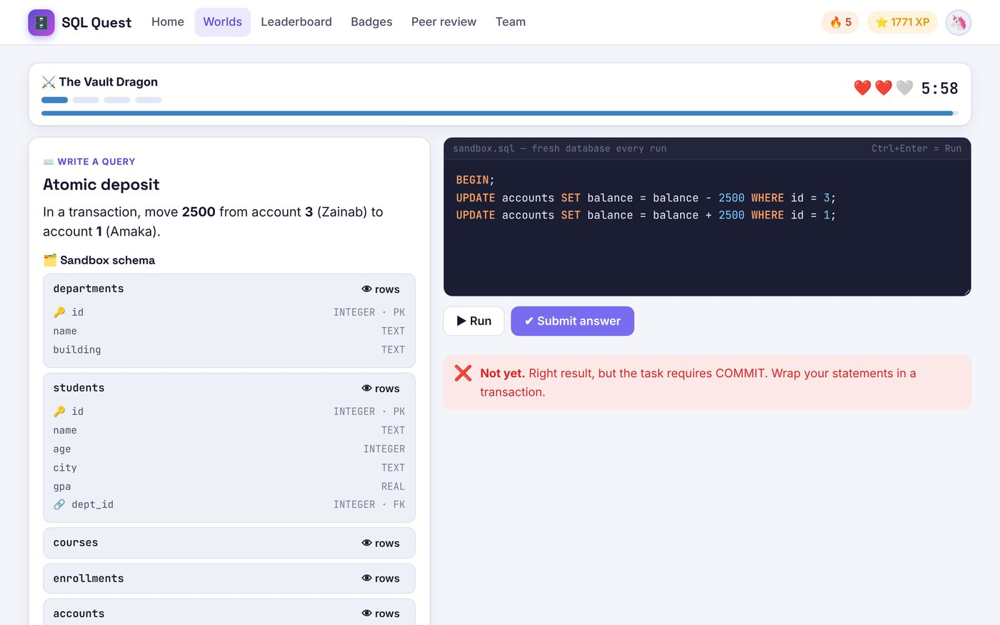 Boss battle | 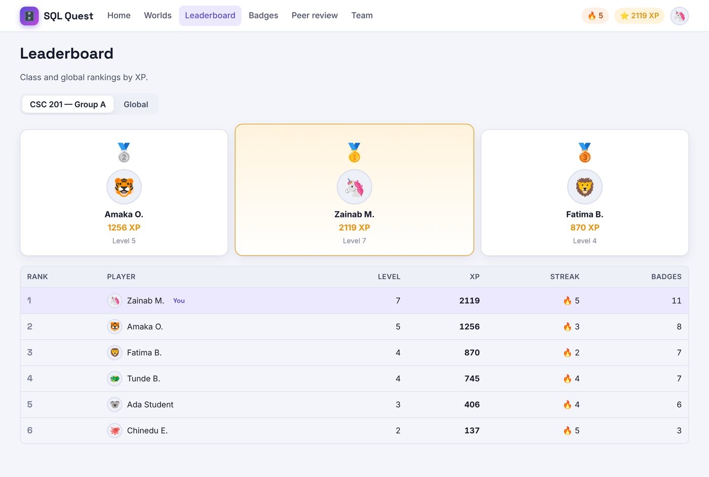 Leaderboard |
| 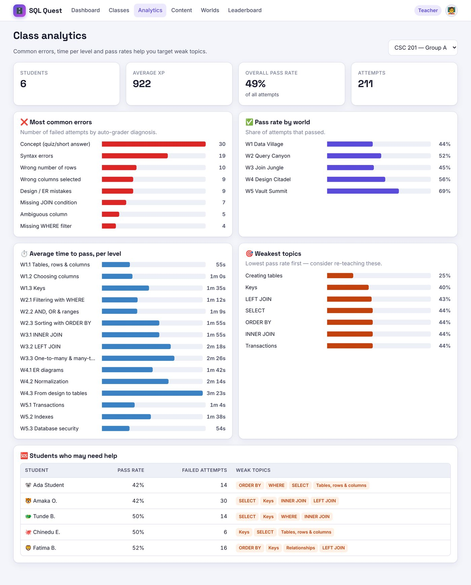 Teacher analytics | 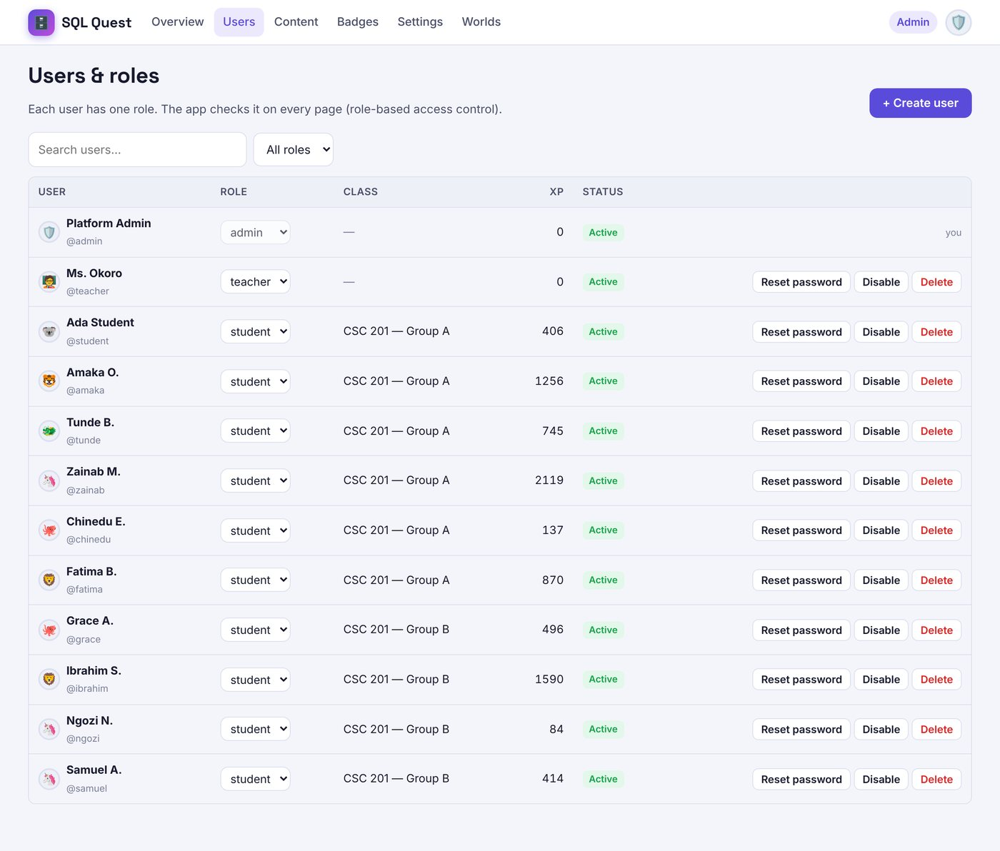 Admin users |

All screens are in [`screenshots/`](screenshots/).
